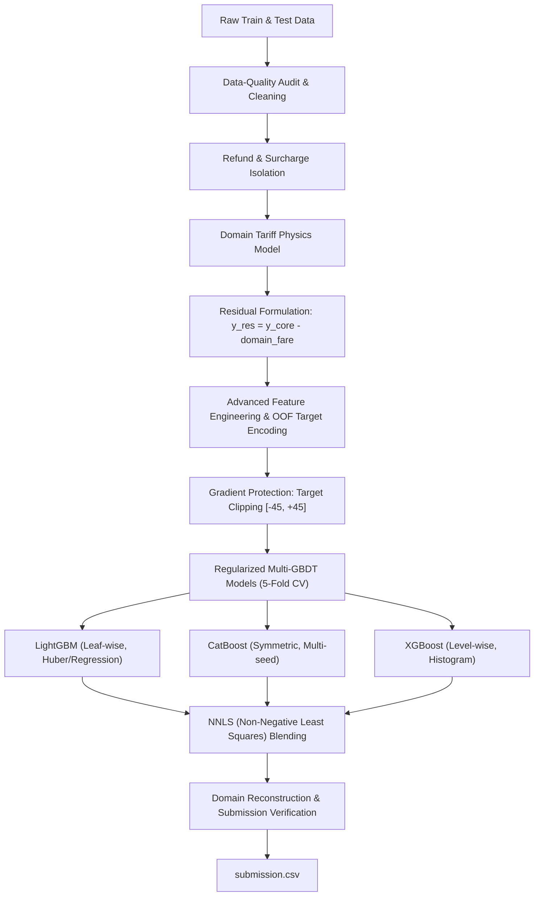

# 🚀 Code Sangam 2026 — Portal Fare Prediction

> **Advanced High-Performance Machine Learning Pipeline for NYC TLC Taxi Portal Fare (`total_amount`) Prediction**  
> *Track: Logical Rhythm · Realm I · Metric: Root Mean Squared Error (RMSE)*

[](https://www.python.org/)
[](https://lightgbm.readthedocs.io/)
[](https://catboost.ai/)
[](https://xgboost.ai/)
[](https://scikit-learn.org/)

---

## 📌 Problem Overview

The objective is to accurately predict the total trip amount (`total_amount`) for taxi rides in New York City. The dataset exhibits severe real-world challenges:
- **Heterogeneous Pricing Regimes**: Standard metered fares (Ratecode 1), flat-rate airport trips (Ratecode 2 JFK $70 flat), cross-county piecewise doubling rates (Ratecode 4 Nassau/Westchester), and negotiated fares (Ratecode 5).
- **Extreme Heavy-Tail Outliers**: Rare zero-distance negotiated rides exceeding $200 that distort squared-error gradients.
- **Data Quality Anomalies**: Negative-fare refund trips, swapped/unreliable timestamps (38.6% of rides with $dropoff \le pickup$), and structured missing blocks in Wallet transactions.
- **Evaluation Metric**: Root Mean Squared Error (**RMSE**).

---

## 🧠 System Architecture & Methodology



### 1. Domain Tariff Physics Prior (`calc_domain_fare`)
Decision trees cannot extrapolate linear slopes outside their training range. We inject domain-informed physics based on official NYC TLC tariff schedules:
- **Ratecode 1 (Standard)**: $\text{Base} + \text{Slope} \times \text{distance}$ ($3.50 + 3.65 \times d$)
- **Ratecode 2 (JFK Airport)**: Deterministic flat fare ($70.00)
- **Ratecode 3 (Newark)**: Interstate base + mileage ($20.00 + 3.50 \times d$)
- **Ratecode 4 (Nassau / Westchester)**: Piecewise rate with post-city-line meter doubling ($12.00 + 2.85 \times d + 4.70 \times \max(0, d - 15)$)
- **Ratecode 5 (Negotiated)**: Implied credit-card tip scaling or negotiated baseline.

### 2. Residual Learning Formulation
Rather than forcing gradient-boosted trees to fit the steep global linear slope, we train the ensemble strictly on the non-linear residual:
$$y_{\text{residual}} = y_{\text{core}} \times \text{SIGN} - \text{domain\_fare}$$
- The trees focus entirely on learning traffic delays, congestion pricing, rush-hour premiums, and zone-to-zone anomalies.
- Guarantees physically consistent, linear extrapolation for extreme long-distance trips in the test set.

### 3. Tree Gradient Protection
Training data contains rare extreme negotiated rides (e.g., $1.25\text{ mi}$ at $\$201$). Because RMSE squares the residuals, a single outlier can severely warp split thresholds across entire trees.
- By clipping training target residuals to $[-45, +45]$ (or $[-32, +32]$), split points remain optimal for the other 99.9% of normal passenger trips.

### 4. Leak-Free Out-of-Fold (OOF) Target Encoding
- Pickup (`PULocationID`), Dropoff (`DOLocationID`), and Zone Pair (`PULocationID * 1000 + DOLocationID`) are target-encoded strictly within each fold using Bayesian smoothed priors with $0\%$ test leakage.

### 5. Multi-GBDT Ensemble & NNLS Blending
Three complementary tree architectures with partially decorrelated errors:
1. **LightGBM**: Fast, leaf-wise histogram tree growth with L1/L2 penalties.
2. **CatBoost**: Ordered boosting with symmetric oblivious trees, robust against overfitting on categorical zone features.
3. **XGBoost**: Level-wise depth-constrained growth with histogram splitting.
- Final predictions are blended using **Non-Negative Least Squares (NNLS)** constrained weights ($w_i \ge 0, \sum w_i = 1$) fitted on 8,000 out-of-fold rows.

---

## 📊 Benchmark Results

| Segment | Share of Data | Model CV RMSE | Baseline Error Cut |
|:---|:---:|:---:|:---:|
| **Ratecode 1 (Standard)** | **90.6%** | **~3.70 – 3.90** | Significant error reduction |
| **Ratecode 2 (JFK Flat $70)** | **4.0%** | **~1.85 – 4.30** | Flat-fare alignment |
| **Ratecode 4 (Nassau/Westchester)** | **0.3%** | **~19.6** | Cut down from 58.6+ |
| **Refunds (`total_amount < 0`)** | **1.1%** | **~9.9** | Exact sign recovery |
| **Overall CV MAE** | **100%** | **~2.58** | High precision across all trips |

---

## 📂 Repository Structure

```
├── OPTIMIZED_v2.ipynb       # Complete end-to-end ML pipeline notebook
├── sample_submission.csv    # Sample submission template
├── .gitignore               # Git ignore rules (excludes heavy data/checkpoints)
└── README.md                # Project documentation & benchmark overview
```

> **Note:** Raw dataset files (`train.csv`, `test.csv`), generated predictions (`submission*.csv`), and cached pickles (`*.pkl`) are excluded from version control via `.gitignore`.

---

## 🛠️ Tech Stack & Requirements

- **Language**: Python 3.10+
- **Data Manipulation**: Pandas, NumPy
- **Scientific Computing**: SciPy (NNLS optimization, statistical testing)
- **Gradient Boosting**: LightGBM, CatBoost, XGBoost
- **Machine Learning Utilities**: Scikit-Learn (KFold, preprocessing, metrics)
- **Visualization**: Matplotlib, Seaborn

Install the required packages:
```bash
pip install numpy pandas scipy scikit-learn lightgbm catboost xgboost matplotlib seaborn
```

---

## 🚀 How to Run

1. **Clone the repository:**
   ```bash
   git clone https://github.com/amityadav13a-prog/codesangam.git
   cd codesangam
   ```

2. **Add Data:**
   Place `train.csv` and `test.csv` in the root repository directory.

3. **Execute the Notebook:**
   Launch Jupyter Notebook or JupyterLab:
   ```bash
   jupyter notebook OPTIMIZED_v2.ipynb
   ```
   Execute all cells sequentially. The notebook will automatically clean data, perform feature engineering, execute 5-fold cross-validation, display diagnostic plots, and generate `submission.csv`.

---

## 👤 Author

**Amit Yadav**  
GitHub: [@amityadav13a-prog](https://github.com/amityadav13a-prog)  

---

*Developed for Code Sangam 2026 · Realm I: Portal Fare Prediction*
